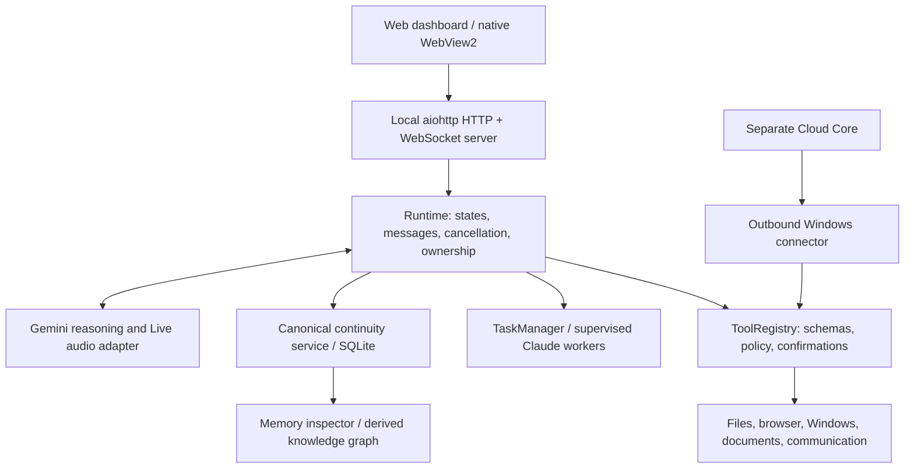

# LUMINA project handoff and memory audit

Scanned: 18 October 2026, Asia/Katmandu. Workspace: `D:\R O C H A K\LUNA 3`.

## Read this first

LUMINA is Rochak/Scepter's personal Windows AI butler and operating interface. Its intended division is: the model reasons; the local runtime owns tools, permissions, confirmations, task lifecycle, memory and UI state. The project has progressed far beyond its original orb-and-file-search prototype.

**The latest retained release evidence is the final roadmap build verified on 10 October 2026. This transferred folder is incomplete and cannot currently reproduce that release. Restore completeness before changing the memory engine.**

The most useful next product improvement is reliable, evidence-backed continuity: remember the right things, retrieve them consistently, and explain exactly where work stopped. Adding a vector database first would not resolve the storage, scope, privacy and continuation gaps below.

### Evidence labels used here

- **Observed:** checked in the current folder or read directly in surviving code.
- **Recorded:** claimed by retained audit documents or verification artifacts from earlier sessions; not rerun today.
- **Snapshot finding:** read in a surviving portable source copy, because the corresponding root source is missing. Must be reconciled against restored authoritative source before fixing.
- **Proposed:** an improvement or next step, not implemented by this scan.

This is a static investigation and handoff, not a claim to have read every generated binary or certified every feature. No production application was started, no online inference was requested, and no personal database was opened or changed. Credential file contents were not read. Bytecode and packaged executables were not decompiled.

## 1. Where work appears to have stopped

**High confidence:** the last retained release milestone was completion of the three legacy integration phases, after the continuity engine, personal seed import/repair, and Cloud Phase 2 connector work.

| Milestone | Retained evidence | What it establishes |
|---|---|---|
| Local continuity engine | `docs/CONTINUITY_IMPLEMENTATION.md` | Recorded 957 passing tests, one skipped; canonical memory, evidence, temporal correction, continuation, inspector and migration |
| Personal continuity seed and live recall repair | `docs/CONTINUITY_SEED_AUDIT.md` | Recorded 127 imported records; repair of first-person recall and Windows virtualized-storage mismatch; final repair regression 1,032 passed, two skipped |
| Cloud Phase 2 | `docs/CLOUD_PHASE2_RESULTS.md` | Recorded 1,232 passed, three skipped; supervised outbound Windows connector and separate approval/disclosure |
| Final legacy roadmap release | `docs/LEGACY_FEATURE_ROADMAP.md`, `artifacts/roadmap-final-audit.json` | Audit UTC `2026-10-10T04:06:12.4327534Z` = 09:51 Nepal time; recorded 1,398 passed, two skipped, plus one private-review UI test |
| Final package acceptance | `artifacts/roadmap-final-portable-capabilities.json`, `artifacts/roadmap-final-desktop-verification.json` | Earlier packaged imports, durable text restoration, ZIP validation, supervised plugin, bundled browser, owned/reused server behavior and native WebView loading |

The final package was `dist/LUMINA-Portable-Roadmap-Final-20261010`. Its surviving `LUMINA.exe` SHA-256 is:

`67924DD58878C9F9D16A2377468A34955ACE212A07C2F7ADF9BAB96D124D69D0`

**Observed:** this matches the recorded final audit hash. It identifies the launcher; it does not prove that the current package's application files and dependencies are complete.

The last surviving session log (`logs/sessions/20261009-100312-06206105.log`) records initialization on 9 October at 10:03 UTC, Gemini provider, Claude worker, memory ready and IDLE. It contains no unfinished task or conversation. Therefore **the exact last user request cannot be recovered from this log**. The release milestones provide stronger stopping-point evidence than this short session record.

Do not interpret imported seed goals as currently running tasks. The seed audit explicitly distinguishes historical desires and plans from active execution. Current open loops cannot be established without inspecting the actual application's canonical database later.

### Remaining acceptance at the last recorded milestone

- Real public cloud deployment, domain/TLS, real OIDC login, cloud Gemini reasoning, phone on another network and PC-off operation were not certified.
- Cloud devices require an online existing Windows backend; there is no installed auto-start service.
- Bidirectional personal-memory sync, automatic conversation/voice handoff, native Android tools and remote Claude execution were not implemented.
- Physical audio, multiple monitors/DPI and authenticated external integrations still had acceptance gaps. Earlier successful synthetic Gemini document/vision probes do not certify a real memory voice conversation.
- The final package is recorded as unsigned. Browser external commits/transfers and system power controls remained unavailable.

## 2. Current folder health: recovery is the first gate

### What is actually present

The initial inventory, excluding generated `__pycache__`, dependency, `bin` and `obj` files, found 31 files in `lumina`, 16 in `web`, 25 in `tests`, five in `scripts`, 12 in `docs`, 86 in `sources`, no direct desktop source files, and two camera-helper source/project files. These counts describe this copy, not the intended project size.

`docs/PROJECT_SCAN_INVENTORY.json` records selected required paths and surviving portable copies. It was generated before this report and the inventory itself were added.

**Observed missing critical root files:**

- Startup/configuration: `lumina/__main__.py`, `lumina/config.py`, `lumina/server.py`, `lumina/speech.py`.
- Memory engine: `lumina/memory.py`; continuity `models.py`, `admission.py`, `service.py`, `repository.py`, `retrieval.py`, `state.py`, `bootstrap.py` and package initializer.
- Provider contracts: `lumina/providers/base.py`, `lumina/providers/budget.py`.
- Frontend: `web/app.js`, `web/graph.js`, `web/continuity.js`; additional styles/modules referenced by `web/index.html` are also absent.
- Development/build: `.venv/pyvenv.cfg`, `desktop/LUMINA.csproj`, `scripts/build_desktop.ps1`.

Root continuity currently contains `graph.py`, `policy.py`, `migrations/001_initial.sql` and orphan cache files. `lumina/runtime.py:16` imports missing `memory.py`; `tests/test_continuity_core.py:6` imports missing `service.py`; `policy.py:33` depends on missing `models.py`. This is missing-file damage, not merely a dependency-install problem.

`.git` exists but lacks usable repository metadata. Both `git status` and `git log` report “not a git repository.” There is no reliable branch, commit history or dirty-file baseline available in this copy. Older audits describe Git checks; those remain historical evidence.

### What was verified today

The existing `.venv/Scripts/python.exe` fails even for `--version`:

> failed to locate pyvenv.cfg: The system cannot find the file specified.

An attempt to collect `tests/test_continuity_core.py` fails at the same interpreter boundary. **No current tests ran. Historical green results must not be presented as current passes.**

Directory timestamps clustered on 18 October suggest a copied/transferred tree, while retained files and reports describe work through 10 October. This is an inference; the scan does not establish how or why files disappeared. Artifact filesystem modification dates also disagree with some embedded UTC verification dates. Prefer embedded timestamps plus content, not modification time alone.

### Portable copies are recovery clues, not a complete backup

| Missing root component | Surviving source location |
|---|---|
| Memory facade | Four portable app copies; final roadmap copy inspected |
| Repository | Both roadmap packages |
| Retrieval | `dist/LUMINA-Portable-Roadmap-20261010/app/lumina/continuity/retrieval.py` |
| State/continuation | Both roadmap packages |
| Bootstrap importer | Final roadmap package |
| Frontend app/graph/inspector | Some portable packages; coverage differs |
| Service/admission/models, server and speech | No corresponding source found under `dist` |

Blindly copying one portable `app` directory over the root will not restore the project. Mixing components across snapshots can introduce contract mismatches. No such copying was performed.

The historical source path was `C:\Users\Administrator\Documents\ChatGPT\LUNA 3`; this scan is of the new D: path. Treat old absolute paths in reports/configuration as migration clues, not current workspace locations.

## 3. Architecture and ownership

The server and some components shown here are reconstructed from imports, tests and audits because their source is absent.

| Area | Responsibility and important files |
|---|---|
| Runtime | `lumina/runtime.py`: eight states, selected user evidence, task/tool outcomes, local command routing, provider dispatch, bounded transcript and graph revisions |
| Tool authority | `lumina/tools.py`: typed declarations, permission boundary, confirmations, cancellation, result limits, integrations. Model output cannot grant itself authority |
| Reasoning/audio | `lumina/providers/gemini.py`; `web/voice.js`, `web/call.js`: direct Gemini adapter, tool exchanges, Live PCM/transcription; no automatic alternate paid provider |
| Files/workspace | `filesystem.py`, `upload_workspace.py`, `file_controller.py`, `known_folders.py`: bounded discovery, uploaded inputs, reviewed changes, durable journals/recovery |
| Task delegation | `tasks.py`, worker adapters referenced by runtime, `worker_terminal.py`: explicit delegation, lifecycle observations and cancellation; full worker source is incomplete here |
| Native host | Intended .NET 10 Windows WebView2 shell; `camera-helper/Program.cs` is separate native camera support. Native launcher source is missing |
| Frontend | `web/index.html` declares Dashboard, Chat, Workers, Workspace, Knowledge, Automation, Capabilities, Memory, Controls and Settings; force-graph/Three.js rendering |
| Cloud/device | `cloud/runtime.py`, `cloud/devices.py`, `cloud/memory.py`, `device_connector.py`, `device_protocol.py`: separate cloud composition, device identity/queues, reviewed memory transfer, local approval and result disclosure |
| Legacy/reference material | `sources/`: prior actions/core/scheduler/dashboard plus supplied UI prototype. These are reference/adaptation material; do not assume they are the current app's entry point |
| Notes graph | `notes/`, `graphify-out/`: separate knowledge source. Canonical continuity can drive Automatic/Memory graph mode; Notes remains independently selectable |
| Evidence | `docs/` describes behavior and qualifications; `artifacts/` retains reports/screenshots/backups. Neither is an alternative canonical memory store |

The README contains prototype-era statements such as memory and desktop control being out of scope, alongside later configuration updates. It is not a reliable single current feature specification. The roadmap and implementation audits supersede those older scope statements.

## 4. Memory system: what it really is

### Storage layers

1. **Canonical SQLite continuity:** durable facts, provenance, temporal state, goals and unfinished responsibilities.
2. **Legacy notes facade:** old integer IDs and `memories` rows map to canonical facts through `legacy_memory_map`. Arbitrary saved text remains unparsed; explicit preference syntax has narrow parsing in the recovered facade.
3. **Current state / continuation:** disposable projections reconstructed from canonical records and observed events.
4. **Knowledge graph:** a bounded presentation projection with explicit relationships and evidence. Community grouping does not establish new facts.
5. **Conversation/session logs:** recent context and diagnostics, not the durable source of truth. Runtime messages are bounded to 40; session logging retains three files and redacts recognizable credentials.
6. **Cloud memory:** explicit reviewed one-way record bundles with separate cloud-storage and provider-use consent. This is not ongoing synchronization.

The recovered facade defaults to `%LOCALAPPDATA%/LUMINA/memory.sqlite3` with explicit configuration/environment overrides. Moving this project folder does **not** prove personal memory moved with it. Four seed backup databases remain under `artifacts`; their contents were not read. They are historical copies, not evidence of the current database's state.

The prior seed repair exposed a particularly important Windows trap: MSIX virtualization gave an editing process and the native app apparently matching LocalAppData paths backed by different files. Future memory checks must establish the real running process, resolved store and record identities together. Do not diagnose “the model forgot” until verifying that the application is reading the intended database.

### Canonical schema

Observed in `lumina/continuity/migrations/001_initial.sql`:

| Tables | Purpose |
|---|---|
| `entities`, `events`, `evidence` | Stable identities; observations; source links explaining claims |
| `facts` | Current/disputed/historical beliefs with confidence, stability and validity intervals |
| `episodes`, `episode_events` | Session/event summaries and their membership |
| `decisions`, `goals`, `commitments`, `open_loops` | Choice/rationale, intent, responsibility and unfinished work |
| `relationships` | Explicit typed links |
| `memory_candidates` | Proposed records and admission decisions |
| `predictions`, `behavior_patterns` | Uncertain hypotheses, not facts |
| `current_state`, `memory_fts` | Rebuildable projection and FTS5 lexical index |
| `legacy_memory_map`, `schema_migrations`, `meta` | Compatibility, migrations and metadata |
| `sync_outbox` | Transactional mutation metadata; does not itself send data anywhere |

Canonical rows carry UUID identities, versions, privacy/sync policy and timestamps. SQL indexes support project/status/time access; events reject updates. The recovered repository enables WAL, foreign keys and transactions/savepoints, uses backup-before-migration and does not silently replace a corrupt database.

### Write path and authority

`Runtime.capture_user_evidence` records selected meaningful user text; recognizable credentials and small talk are rejected. `continuity_task` records actual lifecycle transitions. `continuity_tool` stores selected outcome metadata, excluding raw arguments, file contents and worker output (`runtime.py:139`, `:156`, `:162`).

Model proposals pass through typed schemas. The conversational mutation path prepares candidates and requires an expiring confirmation tied to exact content/version (`continuity_commands.py:212`, `:244`, `:258`). A direct explicit “remember …” command is a separately authorized local save (`runtime.py:352`). Do not impose an extra dialog on that existing explicit-save path without a product decision.

Core test contracts distinguish create, duplicate, reinforce, contradict and supersede; reject forged authority/provenance; preserve correction history; check transactional rollback, concurrent admission and secret exclusion. **The central service/admission implementation is missing**, so these contracts cannot currently be certified from executable code.

### Read path and model access

Recovered retrieval uses FTS5 and structured scopes/intent expansion, then relevance, authority, confidence, stability, freshness and importance. It is lexical/structured retrieval, not embeddings. Facts support validity-time filtering and historical recall. Evidence packs are bounded and include uncertainty.

The local Gemini adapter receives recent conversation, system policy and tool declarations (`gemini.py:57`). The normal runtime calls `provider.generate(text, handle_tool_call)` (`runtime.py:774`). No automatic durable continuation injection is visible in this normal generation path. Memory is mainly available through explicit local routing or model-selected tools. The separate cloud runtime does inject consent-filtered memory/context.

This distinction matters: durable storage alone does not guarantee that a model uses it for a vague request such as “let's carry on.” Evaluate selection, retrieval and final answer separately.

### Existing strengths to preserve

- Beliefs and observations are distinct; model prose does not prove task success.
- Provenance, contradiction, correction and temporal history are first-class concepts.
- Project scopes and privacy policies exist; no automatic action follows a prediction.
- Continuation and graphs are rebuildable views, rather than competing databases.
- Legacy import is idempotent; the seed importer uses reviewed quotations/hashes and correction/forgetting protection.
- Forgetting distinguishes removal from current recall and permanent erasure; backups/logs are separate retained copies.
- The test design covers substantial failure cases. Reuse it after recovery rather than replacing the engine wholesale.

## 5. Memory findings and improvement priorities

These are evidence-backed audit targets. Snapshot findings are not proven failures of a currently running app.

| Priority | Finding and evidence | Proposed change and acceptance |
|---|---|---|
| P0 | Incomplete source/runtime prevents exercising admission, persistence, privacy and erasure | Restore coherent source and reproducible environment. Existing continuity tests must collect and pass against disposable storage |
| P1 | Prediction IDs disagree across components: recovered final `state.py:124–133` writes **event IDs** to `evidence_ids_json`; current `cloud/memory.py:251–259` interprets those values as **evidence row IDs** | Define one reference contract; preserve/migrate existing records explicitly. A generated prediction and all dependencies must survive reviewed export/import |
| P1 | Recovered final `state.py:127` deduplicates predictions by phrase/status without project scope | Include project identity and source-loop identity. Identical descriptions in two projects must produce correctly scoped results |
| P1 | Recovered final `state.py:151–164` derives patterns from events without explicit privacy inheritance in inserted data | Propagate strongest source restrictions and audit evidence filtering end to end. Mixed private/device-local/cloud-blocked histories must never weaken policy |
| P1 | Normal local model generation has no visible automatic continuation selection | Build a small, policy-filtered context selector at the runtime boundary, with explicit provenance and uncertainty. Typed and Live requests should resume the same evidenced project after restart without spawning work |
| P2 | Roadmap snapshot `retrieval.py:153` caps each kind at newest 120 SQL candidates **before** final relevance ranking | Rank/select candidates using index relevance and structured conditions before the cap; report incomplete scans. An older highly relevant fact must remain discoverable among thousands of newer matches |
| P2 | Snapshot `retrieval.py:59–61` budgets characters with minimum 512; tool schema `continuity_commands.py:28` permits 256 | Define budget units and one minimum. Enforce bounded serialized output with Unicode tests; add model token estimation separately if needed |
| P2 | Snapshot `retrieval.py:144–145` applies only creation-time cutoff for historical non-fact records; freshness uses today's clock | Either implement versioned history for goals/decisions/loops or explicitly limit historical guarantees. A completed goal must not be described with today's status in a past-state query |
| P2 | Final snapshot `state.py:62` uses a last-200-task-event window to rebuild active task state | Maintain indexed latest observed task state or disclose truncation. Old unfinished work must not disappear after unrelated task activity |
| P2 | Final snapshot `state.py:39` summarizes event counts, not meaningful work | Produce bounded structured handoffs: purpose, observed changes, rationale, completed checks, blocker, next action, source IDs and confidence. A restart answer should explain what to do next |
| P3 | Recorded benchmark is 400 deterministic cases with perfect fixture metrics, not natural-language real-world evidence | Add held-out paraphrases, ambiguous entities, stale facts, noisy histories, missed-tool calls and human-labelled expectations. Measure retrieval and final narration separately |

**Privacy qualification:** the pattern code exposes a policy-propagation concern. Because the service and full retrieval implementation are missing, this scan does not establish a confirmed online disclosure. Treat it as a high-priority contract test after restoration.

### Recommended continuation record

Use the existing entities, goals, decisions, open loops and events before inventing another storage system. A continuation view should contain:

- Project/workspace identity, including aliases after moving folders.
- User goal and chosen approach, linked to actual evidence.
- Last observed completed step and verification result.
- Unfinished task/open loop, blocker, next concrete step.
- Relevant files/artifacts and observation time.
- Confidence, uncertainty and whether task status is merely last observed.

Distinguish user preferences, project constraints and temporary task instructions. A one-off “be brief for this answer” should not silently become a permanent personality preference. Any future extraction model should only propose structured candidates; trusted admission should retain authority.

### When embeddings would help

After source recovery and baseline measurement, optional hybrid lexical/semantic retrieval could improve paraphrases and multilingual questions. Use embeddings as a derived index over approved records, with the same project/privacy/temporal filters and deletion propagation. They must not replace canonical SQLite, evidence, corrections or explicit authority. Evaluate improvement on held-out cases before adding an external embedding dependency.

## 6. Resume plan with stop conditions

### Gate A — Recover a coherent development baseline

1. Locate the original complete working folder, source archive or repository backup. The old C: path in reports is a lead, not a verified surviving copy.
2. Preserve this transferred tree and private backups. Compare candidate source revisions and manifests; use portable snapshots only to recover verified compatible pieces.
3. Restore missing application, frontend, test and build files. Restore real Git history if available; do not fabricate a prior commit baseline.
4. Recreate a supported Python environment from the recovered requirements. Check relocated absolute paths and current memory configuration. Use an isolated database for all tests.
5. Verify startup/import completeness and selected browser assets before touching real user memory.

Stop condition: the complete app imports and runs locally with disposable state; continuity tests collect; source revision and package relationship are known. Do not silently rebuild a different engine just to make imports pass.

### Gate B — Re-establish memory invariants

Run existing core, state, graph, bootstrap, integration and confirmation tests that survive or are recovered. The current folder lacks several of the historically documented tests/benchmark script, so recover those too. Reproduce migration preservation on a read-only-source backup copy; verify integrity, foreign keys, restart, correction history, erasure scope and re-import protection.

Stop condition: current results are saved separately from historical artifacts, with explicit pass/fail/skip counts and any untested limits.

### Gate C — Fix correctness and scope before recall polish

Reconcile prediction reference IDs, scope prediction deduplication, propagate derived privacy, define budget units and repair historical/candidate-limit semantics. Add regression tests that demonstrate the specific failures first.

Stop condition: cross-project duplicates, mixed privacy sources, Unicode budgets, older relevant facts and historical non-fact queries have unambiguous tested behavior.

### Gate D — Make “where did we stop?” useful

Add meaningful source-linked continuation summaries and a bounded context selector shared by typed and Live paths. Surface storage identity and memory health in diagnostics so a wrong-store problem is visible immediately. Keep handoff generation deterministic where possible; optional narrative synthesis must cite observations and preserve uncertainty.

Acceptance scenario: perform a small real project task, leave a recorded blocker, close normally, restart, ask “where did we leave off?”, and receive the correct project, last verified action, blocker and next step without an agent starting automatically.

### Gate E — Evaluate, then broaden

Use realistic labelled recall cases and restart workflows. Measure precision/recall, stale/false-memory rate, project leakage, provenance coverage, context size, latency and answer faithfulness. Only then decide whether embeddings, richer episode synthesis or secure cross-device synchronization offers the next largest benefit.

## 7. Practical instructions for the next session

- Read this file and `PROJECT_SCAN_INVENTORY.json` first.
- Treat the current folder as incomplete; do not assume the final EXE hash means the package is runnable.
- Start at Gate A. Reinstalling packages alone cannot restore missing source.
- Preserve existing memory data and seed provenance; do not rerun imports against a guessed LocalAppData path.
- Use explicit isolated memory storage for tests. Launching the recovered app with defaults can open/migrate real personal memory.
- Keep the current runtime/tool authority and existing local explicit-save behavior intact.
- Do not combine legacy feature Phase 3 with cloud Phase 3. They are different roadmaps.
- The exact last user task and actual current memory counts remain unknown; verify them from the correctly identified live store only after restoration.

## 8. Scan deliverables and limits

Created only this Markdown report and `docs/PROJECT_SCAN_INVENTORY.json`; application code and databases were not changed. The inventory checks selected required paths and package coverage, not all possible dependency files. The final launcher hash was checked. Current test execution was blocked by the incomplete Python environment; the missing source independently prevents a complete run.

The Caveman exploration/cavecrew workflow was used for read-only memory investigation. Computer UI control was unnecessary for a filesystem/source audit. No callable Context7 tool was available in this session; external library documentation was not needed to establish the local findings.

The central limitation is explicit: admission, service, models, server and speech source are absent even from the searched portable copies. Their documented guarantees are preserved here as contracts and historical evidence, not invented implementation details.
