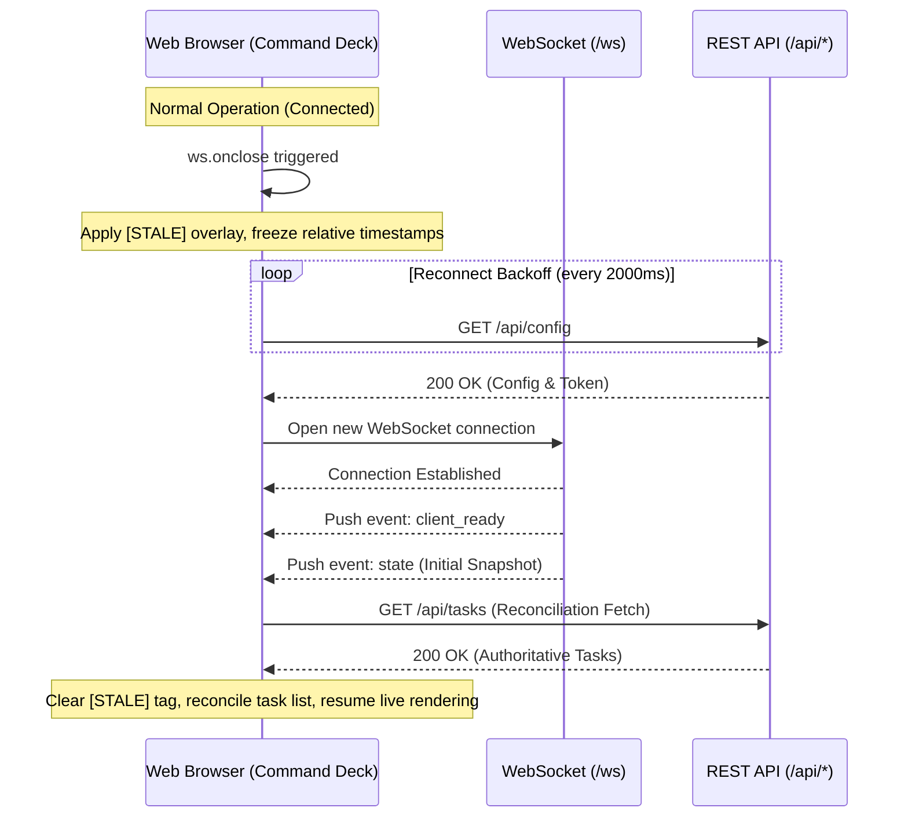

# Lumina Command Deck: Reliability, Performance & Fault Tolerance

**Document ID:** `CD-REL-001`  
**Feature:** Lumina Command Deck (`CD`)  
**Status:** Engineering Reliability Specification / Pre-Implementation  
**Target System:** Lumina AI Companion Dashboard (`Lumina---V2`)  
**Author:** AI Systems Engineering Reliability & Core Team  

---

## 1. Reliability Architecture & Philosophy

The Command Deck is the operational health lens of the entire Lumina application. **A diagnostic panel must be more reliable than the systems it monitors.** If the runtime degrades, the backend throws exceptions, or network sockets drop, the Command Deck must remain completely stable, communicative, and self-healing.

### Core Reliability Invariants:
1. **Never Crash the Host App:** An unhandled exception or malformed JSON payload inside the Command Deck must never crash Lumina's core chat or 3D orb.
2. **Component Isolation:** Failure in one section (e.g. Workspace Monitor) must never cascade into or prevent rendering of other sections (e.g. Live Status or Tasks).
3. **Bounded Resource Footprint:** Memory, DOM nodes, timers, and event listeners must have deterministic upper bounds.
4. **Honest Degraded States:** If data is missing, delayed, or unconfirmed, it must be labeled explicitly as such.

---

## 2. Fault Matrix & Resilience Strategies

| Failure Scenario | Root Cause | Impact on Command Deck | Mitigation & Recovery Strategy |
|---|---|---|---|
| **WebSocket Drop** | Network disconnect / backend restart | Real-time push stream ceases | Retain existing UI; apply `[STALE - RECONNECTING]` tag; start backoff reconnect (2000ms); on re-open reconcile via REST. |
| **Malformed Payload** | Upstream API schema change | Potential JS JSON parse crash | Wrap all event message handlers in `try...catch`; log to browser console; discard invalid message without interrupting state. |
| **Out-of-Order Events** | Network jitter / asynchronous tasks | Newer state overwritten by older state | Check `revision` counter on runtime states and `timestamp` on task updates; ignore events with older revisions. |
| **Duplicate Delivery** | Retries / dual REST + WS delivery | Cluttered duplicate activity feed | Deterministic event ID deduplication (`Set<string>` capped at 500 keys); silent drop of duplicate IDs. |
| **Partial API 500** | Backend task exception | `/api/tasks` fails with 500 error | Isolate section with dedicated error banner: `Task service temporarily unavailable [Retry]`; other sections continue operating. |
| **Massive Error Strings** | Python stack trace > 50KB | DOM bloat and layout breakage | Truncate error strings to first 4,000 characters; display expand button; use CSS `overflow-wrap: anywhere; word-break: break-all;`. |
| **Rapid Mount / Unmount** | User toggling dialog rapidly | Memory leaks / dangling timers | Centralized `destroy()` hook; clear all `setInterval` / `setTimeout` references; unbind window event listeners on close. |
| **Event Flood (Burst)** | Agent tool generating 200 events/sec | Browser UI thread lag | Debounce DOM re-rendering using `requestAnimationFrame`; batch incoming updates in microtasks. |

---

## 3. Bounded Memory & Resource Management

Long-running developer sessions (spanning days in WebView2 or Chromium) require strict memory safeguards:

### 3.1 Bounded In-Memory Activity Buffer
```javascript
class BoundedEventBuffer {
  constructor(maxSize = 150) {
    this.maxSize = maxSize;
    this.events = [];
    this.seenIds = new Set();
  }

  push(event) {
    if (!event?.id || this.seenIds.has(event.id)) return false;
    this.seenIds.add(event.id);
    this.events.unshift(event); // Newest first

    if (this.events.length > this.maxSize) {
      const removed = this.events.pop();
      this.seenIds.delete(removed.id);
    }
    return true;
  }

  clear() {
    this.events = [];
    this.seenIds.clear();
  }
}
```

### 3.2 DOM Node Capping
The Activity Feed DOM container enforces a strict limit:
- Maximum rendered DOM nodes: **100 rows**.
- If older events are retained in the buffer, a `"Load older events..."` button is provided rather than rendering infinite scroll DOM elements.

### 3.3 Zero-Cost Closed State (Polling Discipline)
When `<dialog id="command-deck-panel">` is closed (`dialog.open === false`):
- All high-frequency polling (telemetry sampling) is **completely halted** via `clearInterval`.
- No DOM operations are performed for background activity events. Events simply accumulate silently in the bounded in-memory buffer.
- When the dialog opens (`showModal()`), the UI performs a single reconciliation render.

---

## 4. Section-by-Section Error Boundaries

Each visual section operates inside a localized error boundary:

```javascript
function safeRenderSection(sectionId, renderFunction) {
  try {
    renderFunction();
  } catch (error) {
    console.error(`CommandDeck: Render failed for section #${sectionId}:`, error);
    const container = document.getElementById(sectionId);
    if (container) {
      container.innerHTML = `
        <div class="cd-section-error">
          <span>Operational readout unavailable</span>
          <button type="button" class="quiet cd-retry-btn" data-retry="${sectionId}">Retry</button>
        </div>
      `;
    }
  }
}
```

This guarantees that an unexpected property in a worker adapter's snapshot never prevents the user from checking live runtime connectivity or inspecting security approvals.

---

## 5. Performance Validation & Measurable Targets

All implementations must meet these empirical performance criteria:

| Metric | Target Limit | Measurement Condition |
|---|---|---|
| **Panel Open Latency** | < 80ms | Time from button click to first paint of cached state |
| **Live Update Re-render** | < 16ms (60 FPS) | Time to update a single task status badge on push |
| **Idle Memory Overhead** | < 5MB | JavaScript heap allocation with panel closed |
| **Active Memory Overhead**| < 15MB | Heap allocation with panel open and 150 events in buffer |
| **CPU Utilization (Closed)**| 0.00% | Background CPU consumption when modal is closed |
| **CPU Utilization (Open)** | < 1.0% | CPU consumption during normal 1 event/sec operation |

---

## 6. Self-Healing & Reconnection Protocol

When connection to the Python backend drops and restores:


