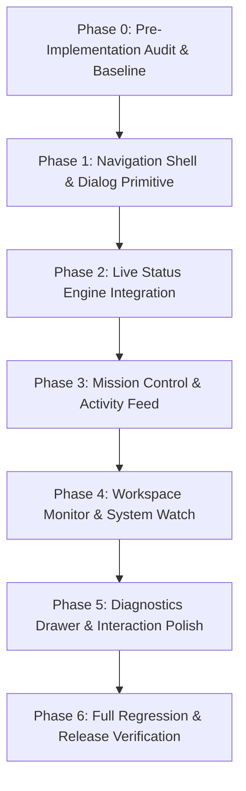

# Lumina Command Deck: Phased Implementation Roadmap

**Document ID:** `CD-ROADMAP-001`  
**Feature:** Lumina Command Deck (`CD`)  
**Status:** Engineering Roadmap / Approved for Future Coding Phase  
**Target System:** Lumina AI Companion Dashboard (`Lumina---V2`)  
**Author:** AI Systems Engineering Architecture Team  

---

## 1. Roadmap Principles & Engineering Strategy

The Command Deck implementation follows a strict **incremental vertical-slice strategy**. Each phase delivers an independently testable, functional capability without breaking existing dashboard features or leaving half-finished dead code in the repository.

### Rules of Engagement:
1. **Never Break Working Systems:** Chat, 3D orb, voice pipeline, memory dialog, and existing worker panels must remain 100% operational after every commit.
2. **Narrowest Touchpoint:** Modify only the minimal necessary files in `web/` (`index.html`, `shell.js`, `app.js`). Keep the Command Deck logic isolated in dedicated files (`web/command-deck.js`, `web/command-deck.css`).
3. **No Premature Complexity:** Implement verified P0 capabilities first. Optional enhancements (P2/Deferred) are strictly locked until P0 achieves full test acceptance.

---

## 2. Phase-by-Phase Execution Plan

---

### Phase 0: Pre-Implementation Audit & Baseline Verification
- **Objective:** Verify Git working tree cleanliness, confirm local Python and Node test runners pass, and lock baseline requirements.
- **Prerequisites:** Clean working directory or isolated feature branch.
- **Specific Work:**
  1. Verify repository status with `git status`.
  2. Execute baseline tests: `pytest tests/test_server.py` and `node tests/motion.test.mjs`.
  3. Validate access to all necessary API endpoints (`/health`, `/api/state`, `/api/tasks`, `/api/audit`).
- **Likely Files:** None modified.
- **Risks:** Uncommitted legacy user changes in working tree.
- **Pass Criteria:** Baseline tests pass; zero unexpected failures.
- **Stop Condition:** If existing test suites fail before any edits, halt and report existing failures before proceeding.

---

### Phase 1: Navigation Shell & Dialog Primitive
- **Objective:** Add the Command Deck navigation button, SVG icon, and base `<dialog>` shell into the Lumina dashboard using the existing visual theme.
- **Prerequisites:** Phase 0 complete.
- **Specific Work:**
  1. Add `<dialog id="command-deck-panel">` container to `web/index.html`.
  2. Add `#command-deck-open` button to `<nav class="nav-rail">` in `web/index.html`.
  3. Register icon path in `web/shell.js`.
  4. Create `web/command-deck.css` defining the responsive layout grid and modal geometry using CSS variables from `web/crimson.css`.
  5. Create `web/command-deck.js` exporting `setupCommandDeck()` to handle modal open/close and keyboard escape handling.
- **Likely Files:**
  - `web/index.html` (Button & dialog markup)
  - `web/shell.js` (SVG icon path)
  - `web/app.js` (Import and initialize)
  - `web/command-deck.css` (New file)
  - `web/command-deck.js` (New file)
- **Risks:** Layout shift or overflow in nav rail on narrow screens.
- **Tests:** Manual test clicking button; verify dialog opens with blurred backdrop; verify `Esc` key closes dialog.
- **Definition of Done:** Command Deck dialog opens and closes cleanly without visual glitches or console errors.

---

### Phase 2: Live Status Engine Integration (`CD-F001`)
- **Objective:** Connect the first real data source: bind `Runtime.state` and WebSocket snapshots to the Live Status header.
- **Prerequisites:** Phase 1 complete.
- **Specific Work:**
  1. In `command-deck.js`, implement state listener subscribed to `window.addEventListener('lumina-event', ...)` and initial `renderState()` hook.
  2. Render the real-time status pill (`IDLE`, `EXECUTING`, `WAITING_FOR_USER`, etc.) using verified badge styles.
  3. Render active tool name and reasoning provider status.
  4. Render pending approval counter.
- **Likely Files:** `web/command-deck.js`, `web/command-deck.css`.
- **Risks:** High-frequency event jitter during audio turns.
- **Tests:** Trigger state changes via local command or text composer; verify Live Status updates instantaneously.
- **Definition of Done:** Live Status reliably reflects the authoritative runtime state in real time.

---

### Phase 3: Mission Control & Activity Feed (`CD-F002`, `CD-F003`)
- **Objective:** Implement task queue monitoring from `TaskManager` and the bounded real-time activity event stream.
- **Prerequisites:** Phase 2 complete.
- **Specific Work:**
  1. Implement `fetchTasks()` calling `GET /api/tasks` with session token headers.
  2. Render task cards with worker badges, instruction snippets, status indicators, and elapsed timers.
  3. Implement `BoundedEventBuffer` (max 150 items) in `command-deck.js`.
  4. Bootstrap event feed from `GET /api/audit` and append live push events (`agent_result`, `state`, `confirmation`).
  5. Implement Category Filter bar (`[All]`, `[Tasks]`, `[Tools]`, `[Approvals]`, `[System]`).
- **Likely Files:** `web/command-deck.js`, `web/command-deck.css`.
- **Risks:** Large task instructions breaking card layout.
- **Tests:** Run mock tasks through `TaskManager`; verify task status transitions update in Mission Control; verify feed caps at 150 items.
- **Definition of Done:** Tasks and operational timeline display real data with active filtering and bounded memory.

---

### Phase 4: Workspace Monitor & System Watch (`CD-F004`, `CD-F005`)
- **Objective:** Integrate workspace context and centralized system alert health desk.
- **Prerequisites:** Phase 3 complete.
- **Specific Work:**
  1. Render workspace path from `config.root` with ellipsis truncation and click-to-copy action.
  2. Render count of uploaded files from existing session state.
  3. Ingest `state.errors`, transport drops, and safety latch alerts into System Watch.
  4. Implement isolated section-level error boundaries (`safeRenderSection`).
- **Likely Files:** `web/command-deck.js`, `web/command-deck.css`.
- **Risks:** Asynchronous clipboard API rejection on insecure origins.
- **Tests:** Test clipboard copy with fallback notice; simulate server disconnect and verify Critical Alert appears.
- **Definition of Done:** Workspace details render accurately; system alerts reflect faults without cascading errors.

---

### Phase 5: Diagnostics Drawer & Interaction Polish (`CD-F006`, `CD-F008`)
- **Objective:** Add task detail inspection drawer, connection recovery synchronization, and visual refinement.
- **Prerequisites:** Phase 4 complete.
- **Specific Work:**
  1. Create Task Diagnostics Drawer (`<aside class="cd-drawer">`) showing detailed task instruction, exit code, modified files, and sanitized error stack.
  2. Implement `[Copy Diagnostics]` markdown export button.
  3. Wire connection drop / reconnect reconciliation handler in `command-deck.js`.
  4. Apply subtle crimson glow and micro-transitions compliant with `prefers-reduced-motion`.
- **Likely Files:** `web/command-deck.js`, `web/command-deck.css`.
- **Risks:** Unsanitized error strings exposing API tokens.
- **Tests:** Verify client-side regex scrubber masks sensitive tokens; verify task drawer opens and closes smoothly.
- **Definition of Done:** Drawer provides rich diagnostics; connection recovery reconciles state seamlessly.

---

### Phase 6: Testing, Regression & Release Verification
- **Objective:** Execute all automated test suites, conduct manual multi-viewport QA, and verify zero regressions.
- **Prerequisites:** Phase 5 complete.
- **Specific Work:**
  1. Author and execute `tests/command_deck.test.mjs` verifying normalization and deduplication.
  2. Execute all Python and Node regression suites (`test_server.py`, `test_control_authority.py`, `motion.test.mjs`).
  3. Perform manual QA on 1920x1080, 1200x800, and 640x900 viewport resolutions.
  4. Inspect `git diff` to ensure zero unintended changes outside the Command Deck integration footprint.
- **Definition of Done:** 100% test pass rate; zero regressions; complete documentation alignment.
