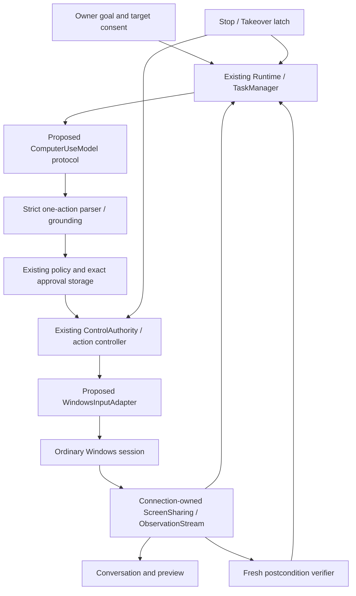

# Chosen architecture — proposed for owner approval
Lumina keeps its existing Runtime, TaskManager, ControlAuthority, IsolatedComputerControl, registry, sharing service and HTTP/WebSocket transport. Preserve LocalGoal recipes and admitted fixture adapters. Add a dynamic runner to the same task manager, a typed model-action boundary and one explicitly registered Windows input adapter. This is an extension, not a replacement application.

**Small module set.** Proposed new files: `lumina/computer_use.py` (dynamic runner), `lumina/computer_use_model.py` (provider-neutral request/parser), `lumina/windows_input.py` (sole general SendInput adapter/held-input ledger), `lumina/computer_geometry.py` (pure transform/target binding). Extend existing `computer_action.py` dataclasses for validated action variants/postconditions, `computer_control.py` explicit adapter registration and verifier contract, `control_authority.py` operation class/admission, existing `computer_windows.py` read catalog and identity. No generic plugin registry, new scheduler, confirmation database, screenshot archive, memory module, worker launcher or session-restoration system.

**Observation lifecycle.** User explicitly shares → validated capture/native geometry → latest stream observation → multiple consumers. Consumer detach and action Stop revoke task bindings, not capture. Stop/pause/source replacement of sharing invalidates pixels and all associated action evidence. Browser captures without native transform cannot supply physical input coordinates. Conservative native request-start monotonic time bounds capture age; receipt age is separately reported. Demand for fresh evidence is coalesced into the existing capture owner; timeout/no source returns unavailable without starting permission or selecting another source.

**Inference delay.** Do not solve stale model frames by increasing timestamps or merely copying a new sequence number. Keep proposal bound to its inference observation. Obtain a new frame before dispatch; either re-identify the exact UIA target or deterministically validate unchanged relevant pixels, dimensions, geometry, target identity and source, recording a derived revalidation proof. Visual-only coordinates without this proof must be replanned from the current image or paused when the finite budget is exhausted. A perceptual similarity score alone is insufficient for consequential authorization. Never recover revoked image access. One stream image plus a bounded in-flight provider payload is transient memory, not retained history.

**Target and input lifecycle.** Current HWND/PID alone is insufficient against reuse. Add process creation identity, window class/generation, desktop/session, physical bounds, geometry revision and foreground evidence. Native input intent binds these facts, observation proof, task owner/generation and expiry. Foreground acquisition is an action with observed success/failure, never a forced activation trick. Model coordinates are frame-relative [0,1), right/bottom exclusive; map via captured physical transform, then SendInput virtual-desktop units. Negative origins and mixed DPI must be tested; no guessed CSS-to-screen mapping.

**Admission versus OS effects (owner decision D1).** Global SendInput has no atomic target HWND or focus assertion. Another process or user can change focus immediately after validation. No Python lock, epoch, UIA token or mutex can fix that OS limitation. A practical ordinary-input mode is possible only with explicit visible control scope, short batches, final foreground/geometry checks, fail-closed drift detection, bounded cleanup, and honest possible misdelivery/unknown outcomes. It must not claim the owned receiver's effect-fencing guarantee.

One executor serializes logical admission under a short shared gate with Stop. Record `admitted` before leaving that gate; Stop must reject every later admission. Do not hold the Stop latch lock over blocking UIA/native work. A previously admitted call may enter/return after Stop: classify it as in-flight, attempt cleanup, never claim rollback. The adapter rechecks the synchronous latch immediately before its fixed OS call as additional mitigation, not atomic target delivery. Unknown work remains retained/quarantined. Unresponsive native calls are not forcibly settled by cancelling an awaiter.

Do not enable broad input by silently weakening the current fixture guarantee. P1.1 specifies and tests the distinction; D1 must be approved before P2 native expansion. If the owner requires atomic no-misdirection or prevention of every post-Stop effect, generic Windows input is unsupported and only cooperative receivers can satisfy that stronger contract. No endless recovery prerequisite is proposed as a substitute.

**Action lifecycle.** Reuse ActionState: proposed → awaiting_approval → approved → revalidating → executing → verifying → succeeded/failed/cancelled/expired. Store effect outcome separately: not_submitted / submitted / partial / unknown and verification matched/failed/inconclusive. A cancelled task may retain unknown cleanup; do not translate it to success. Extend existing digest verifier with explicit typed checks, preserving old digest fixtures unchanged. TaskManager statuses remain authoritative; dynamic progress phases observing/planning/admitting/verifying/recovering map to RUNNING, clarification/approval to WAITING_FOR_USER, uncertain to CLEANUP_UNKNOWN, verified final goal to COMPLETED.

**Model boundary.** One request returns one action, clarification, bounded wait or a proposed completion predicate. No arbitrary tool name, code, shell string, native structures, permissions or approval can enter through the response. Native executor never calls a model. The local policy ignores risk_hint as authority. A model's done statement is evaluated by the verifier. Existing Gemini generate_goal may share low-level transport/privacy logic but cannot serve as an image-action connector unchanged.

**Permission table.** R0: consented observation. R1: identified ordinary reversible navigation within the current armed scope. R2: persistent/local mutation or ambiguous contextual effect, exact owner-reviewed target/effect before first effect and renewed on material change. R3: send/call/payment/delete/install/security/credential or other external sensitive effect: disabled until a separately evidenced trusted approval path binds exact operation/target/parameters/expiry and causal verification; controlled receiver acceptance does not enable production R3. R4: security bypass/secure-desktop/elevation evasion/model code execution denied. A click or keyboard shortcut is never intrinsically R1. Unknown contexts are R2/R3 or denied, never guessed safe. Block Run/terminal/address-bar command execution and shell shortcuts as model escape routes. Application launch requires an approved application identity/surface, not arbitrary text into Run.

**Threat model/non-guarantees.** Screen/UIA/model text is untrusted; it cannot authorize operations. Local web token/client identity gives session routing, not human identity or resistance to malicious same-user code. No protection against compromised OS/admin, perfect pixel grounding, guaranteed focus exclusivity, hard real-time Stop, causal settlement from a UI match, secure-desktop/elevated control, or cross-restart adoption is promised. Preserve unresolved production state; do not clear it to make tests run. All first native work uses fresh isolated Runtime state.

**Verification and recovery.** Every mutation requires fresh post-dispatch evidence and explicit expected state, not just SendInput count. UIA/visual checks are independent reads, not independent security principals. An unmatched desired state does not prove no intermediate side effect. Uncertain consequential operations never replay; read-only reinspection is permitted, mutation waits for resolution/owner. Budget caps apply to actions, elapsed time, requests, response bytes, UIA nodes and retries. Safe no-effect reads may retry once; unverified input defaults zero mutation retries. No task restarts armed. Status/audit contains IDs, times, counts, safe error codes and last verified checkpoint, excluding images/raw private text.
