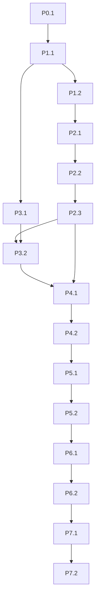

# Authoritative milestone register
Only this file owns IDs, dependencies, status and effort. The owner separately authorized P1.1, P1.2 and P2.1 on 28 October 2026; later implementation rows still require assignment. Each row is one assignable coherent package; function tasks live in CONTRACTS.md. Phase scopes/handoffs are in phases/PHASE-00.md … PHASE-07.md. Astra implements one explicitly assigned row and stops. D1/D2/D3 are decision gates, not fabricated completed dependencies.

| ID | Phase | Milestone | Mandatory dependencies | Status | Active days | Confidence | Requirements | Exit criterion |
|---|---|---|---|---|---|---|---|---|
| P0.1 | 0 | Static audit and plan | — | STATIC_COMPLETE | 1–2 | high | P0 | Source map, reconciled originals and preservation verified; no runtime claim |
| P1.1 | 1 | Typed dynamic-action and admission contract | P0.1 | COMPLETE_FAKE_ONLY | 1–2 | medium | A,C,G,H | Strict one-action parser; new runner fake-only; model done cannot bypass verifier; legacy recipes unchanged |
| P1.2 | 1 | Fresh target, geometry and delayed-inference binding | P1.1 | COMPLETE_FAKE_ONLY | 2–3 | medium | A,B,F | Transforms and source/session/geometry invalidation pass; new frame cannot silently rebind stale coordinates |
| P2.1 | 2 | Native executor facade and no-effect gate | P1.2 | COMPLETE_FAKE_ONLY | 1–2 | medium | B,G | Explicit adapter admission only; race fakes prove no admission after stop; no SendInput activated |
| P2.2 | 2 | Owned native focus, pointer, keys and cleanup | P2.1 | BLOCKED | 3–5 | low | B,G,I | D1 approved; authorized owned fixture verifies focus/move/click/type/chord/scroll and partial-input cleanup; uncertainty retained |
| P2.3 | 2 | Drag, display transitions and measured primitive gate | P2.2 | NOT_STARTED | 2–3 | low | A,B,I,J | Bounded drag release, display/DPI invalidation, fresh captured postconditions; hardware gaps explicitly block broad-display claim |
| P3.1 | 3 | Replaceable image-action provider and fake transport | P1.1 | COMPLETE_FAKE_ONLY | 1–2 | medium | C,H | One provider-neutral schema; images consent-gated; malformed/code output and late replies cannot reach adapter |
| P3.2 | 3 | Zero-cost candidate and native model qualification | P3.1,P2.3 | NOT_STARTED | 2–5 | low | C,I,J | D2 resolved; actual selected model ID/quota/privacy and held-out screen/native scores recorded; no mock substituted |
| P4.1 | 4 | Dynamic observe-plan-act-verify runner | P2.3,P3.2 | NOT_STARTED | 2–4 | medium | C,D,E | Actual Runtime/TaskManager completes randomized native tasks with changing action sequences; each effect verified |
| P4.2 | 4 | Goal predicates, bounded state and progress | P4.1 | NOT_STARTED | 2–3 | medium | D,E,H | Budgets stop loop, model completion checked independently, last verified checkpoint and owner-scoped events agree |
| P5.1 | 5 | Fault, retry and cancellation settlement | P4.2 | NOT_STARTED | 2–4 | medium | F,G | All matrix faults classify no-effect versus unknown; no mutation replay on lost reply; late work retained until actual settlement |
| P5.2 | 5 | Permissions, privacy and restart gate | P5.1 | NOT_STARTED | 2–3 | medium | F,G,H | Risk escalation/approvals exact; R3 production disabled; restart disarmed; logs redact synthetic sensitive canaries; sharing independent |
| P6.1 | 6 | Full product UI and ordinary-app workflows | P5.2 | NOT_STARTED | 3–5 | low | D,E,I | Authorized apps/profiles exercise actual dashboard→Runtime→adapter; at least three ordinary apps incl UIA-poor and cross-app synthetic task |
| P6.2 | 6 | Laptop/PC resource and packaging gate | P6.1 | NOT_STARTED | 2–4 | low | J | 60-minute bounded session + per-stage metrics; agreed numeric resource limits frozen; clean-package check without silent install |
| P7.1 | 7 | Blind acceptance and scoped defect closure | P6.2 | NOT_STARTED | 3–6 | low | A,B,C,D,E,F,G,H,I,J | Pinned unseen corpus meets required rates and zero safety/privacy false-success violations; failures fixed inside existing milestones |
| P7.2 | 7 | Release evidence and limitations decision | P7.1 | NOT_STARTED | 2–3 | medium | A,B,C,D,E,F,G,H,I,J | Every mandatory matrix row has genuine required-tier evidence; owner accepts capability envelope; otherwise incomplete release verdict |

P3.1 may proceed independently of P1.2–P2 once its dependency passes; this is dependency independence, not permission for concurrent shared-file edits. All other listed edges are mandatory. Test-corpus design may proceed without live control; native execution always waits for its gate. Optional within-phase enhancements: scoped UIA events (P1.2/P5.1), adaptive capture/change detection (P6.2), additional provider adapters (P3.1), per-pattern UIA mutation (P2.3 only if evidence resolves its limitation). They cannot block minimum core indefinitely; extra app-specific/file/shell/cloud adapters are outside this release. A newly required major capability or phase change needs owner approval.

Blockers are D1 (ordinary-input guarantee), D2 (viable cost/privacy/model), native target permission, unmeasured multi-monitor hardware and resource limits. R3 production enablement requires D3 and its own operation evidence; production R3 is not silently enabled by controlled-receiver tests. No optional enhancement becomes an implicit prerequisite. Current eligibility is owned by STATUS.md; it must agree with these dependencies.
