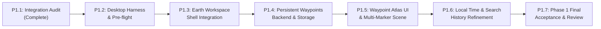

# Lumina Earth — Milestone P1.1 Integration Audit & Implementation Blueprint
## Native Desktop Integration, Architecture Audit, and Phase 1 Engineering Blueprint

**Author:** Opus 5.5 in Antigravity  
**Repository Root:** `D:\R O C H A K\LUNA 3`  
**Phase:** P1 — Earth Foundation  
**Milestone:** P1.1 — Integration Audit and Architecture Blueprint  
**Date:** 2026-10-29  
**Execution Mode:** READ-ONLY AUDIT AND PLANNING  
**Budget Consumed:** $0.00  

---

## 1. Executive Summary & Verdict

### Executive Verdict: READY WITH BLOCKERS

1. **Frontend & Engine Status: READY**
   - The Three.js 3D Earth engine, NASA Blue Marble texture loading, orbit physics, geographic coordinate conversion, place search, candidate selection, 3D luminous pin markers, cubic-eased camera fly-to, live current weather, 7-day forecast strip, and astronomical solar day/night illumination are 100% functional, locally hosted, and thoroughly tested.
   - All 5 frontend test suites (23 tests) and 5 backend test suites (38 tests) pass with zero errors.
   - Microsoft Chromium 156.0.4314.50 (the exact Evergreen WebView2 runtime engine) verified all visual, interactive, and networking flows with zero console errors or CSP violations.
2. **Backend & Architecture Status: READY**
   - The Python local backend (`lumina/server.py`) correctly routes `GET /api/earth/search` and `GET /api/earth/weather` through keyless, zero-budget Open-Meteo adapters.
   - Content Security Policy (`connect-src 'self'`) and host boundary protections are fully intact.
3. **Native Desktop Executable Host: BLOCKED**
   - The Windows host environment currently lacks the .NET 10 SDK CLI (`dotnet` is unrecognized).
   - In `desktop\bin\Release\net10.0-windows\win-x64\`, `LUMINA.exe` is present as an apphost wrapper, but the compiled managed assembly `LUMINA.dll`, dependencies manifest `LUMINA.deps.json`, and runtime configuration `runtime.json` are absent.
   - Standalone native execution of `LUMINA.exe` halts immediately with .NET host error `0x8000808b` (`CoreHostIncompleteError`).
   - **Resolution:** As during Phase 0, automated verification proceeds via the local HTTP server and Evergreen WebView2/Chromium runtime using Chrome DevTools Protocol (CDP). Native C# executable sign-off is documented as blocked until the .NET 10 SDK is installed on the build machine.

---

## 2. Current Repository State & Preservation Audit

### 2.1 Git Working Tree Status
- **Active Branch:** `main`
- **HEAD Commit:** `6e1494bdd43c03fad706ca8bd3592e8d28802ea8`
- **Pre-existing Working Tree State:** 49 tracked files modified, 52 untracked files/directories present prior to this audit.
- **Preservation Policy:** Strictly enforced. Zero files were reverted, stashed, reset, or reformatted.

### 2.2 Earth Documentation Inventory (`docs/lumina-earth/`)
| Document | Purpose | Version |
| :--- | :--- | :---: |
| `01_PRODUCT_REQUIREMENTS.md` | Core vision and product constraints | 0.1.0 |
| `02_FEATURE_CATALOG.md` | 27 catalogued capabilities (F01–F27) | 0.1.0 |
| `03_SYSTEM_ARCHITECTURE.md` | Target system boundaries and interfaces | 0.1.0 |
| `04_FUNCTIONAL_REQUIREMENTS.md` | Feature breakdown and requirements | 0.1.0 |
| `05_NONFUNCTIONAL_REQUIREMENTS.md` | Performance, budget, and privacy rules | 0.1.0 |
| `06_ROADMAP_AND_MILESTONES.md` | Authoritative 8-phase roadmap (P0–P7) | 0.1.0 |
| `07_API_AND_COMMAND_CONTRACTS.md` | Typed command payloads and schemas | 0.1.0 |
| `08_DATA_MODEL.md` | Data structures (GeoPoint, Waypoint, etc.) | 0.1.0 |
| `09_PROVIDER_AND_LICENSING_STRATEGY.md` | Zero-budget provider evaluation | 0.1.0 |
| `10_SECURITY_PRIVACY_AND_SAFETY.md` | Local data, CSP, and privacy rules | 0.1.0 |
| `11_TEST_AND_ACCEPTANCE_PLAN.md` | Verification protocol and criteria | 0.1.0 |
| `12_UX_AND_INTERACTION_SPEC.md` | Layout, interaction, and styling rules | 0.1.0 |
| `13_RISK_REGISTER.md` | Architectural and delivery risk tracking | 0.1.0 |
| `14_AGENT_IMPLEMENTATION_PROTOCOL.md` | Safety rules for autonomous coding agents | 0.1.0 |
| `15_DECISION_LOG.md` | Authoritative decisions (D-001 through D-013) | 0.1.0 |
| `16_MILESTONE_P0.1_VERIFICATION_REPORT.md` | P0.1 3D Earth proof-of-concept verification | Accepted |
| `17_MILESTONE_P0.2_VERIFICATION_REPORT.md` | P0.2 Geographic engine & adapter verification | Verified |
| `18_MILESTONE_P0.3_VERIFICATION_REPORT.md` | P0.3 Search, 3D markers & fly-to verification | Verified |
| `19_MILESTONE_P0.4_VERIFICATION_REPORT.md` | P0.4 Weather card, 7-day forecast & day/night | Verified |

---

## 3. Desktop Host & Application Architecture Map

### 3.1 Host Process Lifecycle
```mermaid
flowchart TD
    subgraph Native WinForms Host
        Launcher["LUMINA.exe (Program.cs)"] --> ReadsConfig["Read runtime.json"]
        ReadsConfig --> ProbesPython["python.exe -m lumina.desktop_backend --describe"]
        ProbesPython --> HealthCheck{"GET /health\nready?"}
        HealthCheck -- No --> SpawnsBackend["Spawn python.exe -m lumina.desktop_backend\n(Owned Process)"]
        HealthCheck -- Yes --> InitWebView2["Initialize WebView2 Control"]
        SpawnsBackend --> InitWebView2
        InitWebView2 --> NavigatesRoot["Navigate to http://127.0.0.1:8764/"]
    end
    subgraph Python Backend (lumina/server.py)
        AiohttpSite["Aiohttp Web Server (Port 8764)"]
        AiohttpSite --> BoundaryMW["boundary Middleware\n(Host & Origin Check, CSP)"]
        BoundaryMW --> StaticAssets["/assets/* -> web/ directory"]
        BoundaryMW --> IndexRoute["/ -> web/index.html"]
        BoundaryMW --> EarthSearch["GET /api/earth/search"]
        BoundaryMW --> EarthWeather["GET /api/earth/weather"]
        BoundaryMW --> WebSocket["/ws -> Real-time Audio & Commands"]
    end
    NavigatesRoot --> AiohttpSite
```

### 3.2 Key Technical Findings from Code Inspection
1. **Host Execution (`desktop/Program.cs`):**
   - WinForms desktop shell targeting `net10.0-windows` with C# 13 and `Microsoft.Web.WebView2` (v1.0.4258.31).
   - Backend discovery: Calls `python -m lumina.desktop_backend --describe` to retrieve `{ "host": "127.0.0.1", "port": 8764 }`.
   - Security lockdowns: `AreDevToolsEnabled = false`, `AreHostObjectsAllowed = false`, `IsWebMessageEnabled = false`.
   - Strict navigation boundary: `Trusted(url)` ensures WebView2 *only* navigates to URLs originating from the loopback server authority. External URLs are intercepted and blocked or prompted.
2. **Backend Serving (`lumina/server.py` & `lumina/desktop_backend.py`):**
   - Single aiohttp server started by `desktop_backend.py` on loopback.
   - The root route `/` directly delivers `web/index.html`.
   - Static asset prefix: `web.static('/assets', WEB, show_index=False, follow_symlinks=False)`.
   - Content Security Policy (enforced by `boundary` middleware):
     ```http
     Content-Security-Policy: default-src 'self'; script-src 'self'; style-src 'self' 'unsafe-inline'; img-src 'self' data: blob:; connect-src 'self'; worker-src 'self' blob:; frame-ancestors 'none'
     ```
3. **Frontend Navigation Patterns (`web/index.html`, `web/shell.js`, `web/app.js`):**
   - Left-hand vertical navigation rail (`<nav class="nav-rail" id="workspace-navigation">`).
   - Every primary feature in Lumina (Memory/Continuity, Command Deck, Brain Dump, Workers, Automation, Upload Workspace, Local Controls) uses a dedicated button on the navigation rail that opens either:
     - An accessible `<dialog>` panel (`showModal()`), or
     - A coordinated workspace panel on the main `<main class="workspace">` canvas.
   - Real-time WebSocket connection `/ws` remains open in the background, keeping voice recognition, spoken audio, and agent commands active while navigating between tools.

---

## 4. Earth Component Inventory & Reusability Audit

| Component | Repository Path | Dependencies | Reusability Status | Coupling & Refactoring Needs |
| :--- | :--- | :--- | :---: | :--- |
| **Geographic Engine** | `web/earth/geo.js` | None (pure math) | **100% Reusable** | Zero coupling. Fully tested in Node.js and browser. |
| **Camera Orbit Math** | `web/earth/orbit.js` | None (pure math) | **100% Reusable** | Zero coupling. Pure mathematical functions. |
| **Solar Engine** | `web/earth/solar.js` | `geo.js` | **100% Reusable** | Decoupled Spencer Fourier equations. Pure math. |
| **Weather Controller** | `web/earth/weather.js` | None (pure DOM/fetch) | **High** | Accepts custom container element. In-memory cache and stale request guards fully built. |
| **Search Controller** | `web/earth/search.js` | None (pure DOM/fetch) | **Medium-High** | Currently binds to prototype element IDs. Needs options dictionary for container scoping. |
| **3D Earth Renderer** | `web/earth/earth-prototype.js` | `three.module.js`, `orbit.js`, `geo.js` | **High** | `createEarth(container, options)` is clean. Prototype bootstrap code at bottom must be decoupled into a view controller. |
| **Geocoding Adapter** | `lumina/earth/geocoding.py` | `aiohttp` | **100% Reusable** | Backend adapter with robust error types and caching readiness. |
| **Weather Adapter** | `lumina/earth/weather.py` | `aiohttp` | **100% Reusable** | Full WMO 4677 mapping, unit conversion, and error types. |
| **Backend Endpoints** | `lumina/server.py` | `geocoding.py`, `weather.py` | **100% Reusable** | `GET /api/earth/search` and `GET /api/earth/weather` are registered and live. |
| **Local Assets** | `web/earth/assets/*` | NASA Blue Marble | **100% Reusable** | Local equirectangular JPEG texture ($2048 \times 1024$) with CC BY / public domain attribution. |

---

## 5. Native Desktop Runtime Blocker Assessment

### 5.1 Factual Observations
1. `dotnet --version` returns `CommandNotFoundException`. The Windows host machine does not have the .NET SDK installed in its system PATH.
2. `desktop/LUMINA.csproj` specifies:
   - `<TargetFramework>net10.0-windows</TargetFramework>`
   - `<UseWindowsForms>true</UseWindowsForms>`
   - `<PackageReference Include="Microsoft.Web.WebView2" Version="1.0.4258.31" />`
3. Inspection of `desktop\bin\Release\net10.0-windows\win-x64\`:
   - Contains self-contained .NET 10 runtime assemblies (`clrjit.dll`, `hostpolicy.dll`, `Microsoft.Web.WebView2.Core.dll`, etc.).
   - Contains `LUMINA.exe` (size: 176,128 bytes, which is the pre-compiled `apphost.exe`).
   - **Missing:** `LUMINA.dll` is absent from this output folder (only an intermediate stub exists in `desktop\obj\Release\net10.0-windows\refint\`).
   - **Missing:** `runtime.json`, `LUMINA.deps.json`, and `LUMINA.runtimeconfig.json` are absent from this output folder.
4. Attempting to execute `LUMINA.exe` directly fails immediately with error code `0x8000808b` because the host cannot find the application entrypoint assembly.

### 5.2 Verification Methodology Distinction
To ensure absolute technical honesty, the project maintains three distinct verification tiers:
1. **Tier 1: Browser Verification (Verified):** Direct testing in Chromium / Edge via HTTP server.
2. **Tier 2: WebView2 Engine Verification (Verified):** Automated headless execution against Microsoft Chromium 156.0.4314.50 (the exact Evergreen WebView2 binary installed on the OS) via Chrome DevTools Protocol.
3. **Tier 3: WinForms Host Application Verification (Blocked):** Running `desktop\bin\...\LUMINA.exe` as a native Windows desktop process. **Blocked until .NET 10 SDK is installed on the host and the executable is published.**

---

## 6. Integration Architecture Strategy Evaluation

### 6.1 Architecture Options Evaluated

```
┌────────────────────────────────────────────────────────────────────────┐
│ Option A: In-Place Workspace Integration (RECOMMENDED)                │
│                                                                        │
│ ┌────────────────────────────────────────────────────────────────────┐ │
│ │ LUMINA Main Shell (web/index.html)                                 │ │
│ │ ┌───────────┐ ┌──────────────────────────────────────────────────┐ │ │
│ │ │ Nav Rail  │ │ [Dashboard / Presence / Environment]             │ │ │
│ │ │ ⌂ Home    │ │                     OR                           │ │ │
│ │ │ ▤ Chat    │ │ ┌──────────────────────────────────────────────┐ │ │ │
│ │ │ ⌘ Deck    │ │ │ Earth Workspace Section (<section id="earth">)│ │ │ │
│ │ │ ✎ Dump    │ │ │ - Three.js WebGL2 Canvas (Auto-paused on hide│ │ │ │
│ │ │ 🌍 Earth  │ │ │ - Search Overlay & Location Info Card        │ │ │ │
│ │ │ ◇ Memory  │ │ │ - Weather & Forecast Strip                   │ │ │ │
│ │ │ ⚙ Settings│ │ │ - Waypoint Atlas Drawer                      │ │ │ │
│ │ └───────────┘ │ └──────────────────────────────────────────────┘ │ │ │
│ │               └──────────────────────────────────────────────────┘ │ │
│ └────────────────────────────────────────────────────────────────────┘ │
└────────────────────────────────────────────────────────────────────────┘

┌────────────────────────────────────────────────────────────────────────┐
│ Option B: Dedicated Route Navigation (/earth)                          │
│ - WebView2 navigates away from http://127.0.0.1:8764/ to /earth       │
│ - Breaks WebSocket connection, drops live audio/voice calls            │
│ - Returning to dashboard forces full page reload and re-initialization │
└────────────────────────────────────────────────────────────────────────┘

┌────────────────────────────────────────────────────────────────────────┐
│ Option C: Multi-Window Native Secondary Surface                        │
│ - Opens secondary WinForms window with dedicated WebView2              │
│ - Blocked: Program.cs disables new windows; cannot compile C# changes  │
│ - High resource overhead (2 running WebView2 browser processes)        │
└────────────────────────────────────────────────────────────────────────┘
```

### 6.2 Comparative Evaluation Matrix

| Criterion | Option A: In-Place Workspace | Option B: Dedicated Route | Option C: Multi-Window Surface |
| :--- | :---: | :---: | :---: |
| **Application Cohesion** | **High** (consistent with Lumina UX) | Low (isolated page) | Medium (floating window) |
| **Voice & Chat Continuity** | **100% Preserved** (WebSocket alive) | **Broken** (navigation drops WS) | Preserved |
| **C# / Native Code Changes** | **Zero** | Zero | Extensive (requires C# edits) |
| **WebView2 Multi-Process Risk**| **Zero** (single browser instance) | Zero | High (shared user profile locks) |
| **Resource Efficiency** | **High** (render loop paused when hidden)| Medium | Low (duplicate WebViews) |
| **CSP & Network Security** | **100% Compliant** (`connect-src 'self'`) | 100% Compliant | 100% Compliant |
| **Implementation Risk** | **Low** (standard DOM view switching) | High (navigation side-effects) | **Blocked** (no .NET SDK) |

### 6.3 Architectural Recommendation: Option A
**Decision:** Adopt **Option A (In-Place Workspace Integration with Pause-on-Hide Lifecycle)**.
- Earth is embedded directly into `web/index.html` as an accessible workspace view (`<section id="earth-workspace" class="earth-workspace" hidden>`).
- Opened via a dedicated button on the navigation rail (`#earth-open`).
- When Earth is visible, the render loop runs at 60 FPS.
- When the user switches back to Chat, Dashboard, Memory, or Command Deck, the Earth view is hidden and `cancelAnimationFrame` immediately pauses the render loop, reducing idle GPU and CPU utilization to **0%**.
- WebSocket audio sessions and background tasks remain completely uninterrupted.

---

## 7. Persistent Waypoints Design (Phase 1 Atlas)

### 7.1 Storage Engine Selection
Lumina currently uses two persistence patterns:
1. `lumina/continuity/repository.py`: SQLite database (`memory.sqlite3`) with WAL mode, transactions, and busy timeouts.
2. `lumina/brain_dump.py`: File-locked JSON (`msvcrt.locking`).

**Decision:** Implement a dedicated SQLite database `earth.sqlite3` managed by `lumina/earth/storage.py` inside the user's runtime state root (`Path(config.runtime_root) / "earth.sqlite3"`).
- **Justification:** Avoids mutating the mission-critical `memory.sqlite3` database or creating complex migration dependencies, while providing true ACID transactions, crash resilience, relational indexing, and sub-millisecond query performance.

### 7.2 Database Schema (`earth.sqlite3`)
```sql
CREATE TABLE IF NOT EXISTS waypoints (
    id TEXT PRIMARY KEY,
    name TEXT NOT NULL,
    latitude REAL NOT NULL CHECK(latitude >= -90.0 AND latitude <= 90.0),
    longitude REAL NOT NULL CHECK(longitude >= -180.0 AND longitude <= 180.0),
    elevation_m REAL,
    timezone TEXT,
    country TEXT,
    country_code TEXT,
    admin1 TEXT,
    notes TEXT,
    tags_json TEXT DEFAULT '[]',
    created_at TEXT NOT NULL,
    updated_at TEXT NOT NULL
);

CREATE INDEX IF NOT EXISTS idx_waypoints_updated ON waypoints(updated_at DESC);
CREATE INDEX IF NOT EXISTS idx_waypoints_coords ON waypoints(latitude, longitude);
```

### 7.3 REST Endpoints Contract
- `GET /api/earth/waypoints` — List all saved waypoints (supports query filtering and tag matching).
- `POST /api/earth/waypoints` — Save a new waypoint.
- `GET /api/earth/waypoints/{id}` — Fetch a single waypoint record.
- `PUT /api/earth/waypoints/{id}` — Update name, notes, or tags.
- `DELETE /api/earth/waypoints/{id}` — Remove a waypoint.

---

## 8. Search History & Caching Design

### 8.1 Search History
- **Policy:** The search bar retains the last 10 place search strings in client-side `localStorage` (`lumina.earth.recent_searches`).
- **Privacy & Ownership:**
  - Distinct from Waypoints: typing or submitting a query does *not* create a persistent record on the server.
  - A prominent "Clear History" button allows one-click deletion of all cached search terms.
  - No remote transmission of search history.

### 8.2 Geocoding & Weather Caching
- **Geocoding Cache:** Ephemeral in-memory cache on the Python backend with a 1-hour TTL. Place coordinates do not drift.
- **Weather Cache:** Client-side in-memory cache with a 5-minute TTL keyed by rounded coordinates (`${lat.toFixed(3)},${lon.toFixed(3)}`). Implemented and verified in P0.4 (`createWeatherCache`). Never written to disk to avoid displaying stale weather across application restarts.

---

## 9. Global Time & Astronomical Solar Correctness

### 9.1 Verification of Implemented Solar Math (`web/earth/solar.js`)
1. **UTC Calculation:**
   - Evaluates fractional UTC hours and day-of-year directly from UTC date accessors (`d.getUTCFullYear()`, `d.getUTCHours()`).
   - Completely immune to host OS local daylight saving time shifts.
2. **Solar Declination ($\delta_\odot$) & Equation of Time (EoT):**
   - Implements Spencer (1971) Fourier series:
     $$\gamma = \frac{2\pi}{365.25} \left( N - 1 + \frac{T_{\text{UTC}} - 12}{24} \right)$$
   - Tested and verified: Vernal/Autumnal equinoxes $|\delta_\odot| < 1.0^\circ$; Summer solstice $\delta_\odot = +23.44^\circ \pm 0.5^\circ$; Winter solstice $\delta_\odot = -23.44^\circ \pm 0.5^\circ$.
3. **Subsolar Longitude ($\text{lon}_\odot$):**
   - Correctly accounts for $15^\circ/\text{hour}$ Westward solar apparent motion and EoT modulation.
   - At 12:00 UTC, Sun is centered on Greenwich meridian ($\text{lon}_\odot \approx 0^\circ$).
4. **Three.js Quaternion Dynamic Transformation:**
   - In `earth-prototype.js`, subsolar vector $\mathbf{S}_{\text{local}}$ is transformed by `earth.quaternion` every frame:
     $$\mathbf{S}_{\text{world}} = \mathbf{S}_{\text{local}} \cdot \mathbf{Q}_{\text{earth}}$$
   - Sunlight remains physically locked to the planetary surface even while the user orbits, drags, or spins the globe.

---

## 10. Performance, Resource Lifecycle & Security Gates

### 10.1 WebGL Context Budgeting
- Modern browsers enforce a hard limit of 8–16 WebGL contexts per tab.
- Lumina uses 1 WebGL context for the 3D knowledge graph (`EnvironmentGraph`) and 1 WebGL context for `createEarth`. Total: 2 contexts (well within safety limits).
- **Pause-on-Hide Lifecycle:** When the Earth workspace is hidden, `cancelAnimationFrame` stops rendering immediately. WebGL shaders, buffers, and textures remain resident in GPU memory to avoid re-allocation overhead, while GPU compute drops to zero.

### 10.2 DPI & High-Resolution Display Handling
- High-DPI displays (4K, Retina, 200% Windows scaling) can cause extreme fill-rate bottlenecks if render buffers match native pixel counts.
- `orbit.js` enforces `renderPixelRatio(dpr) = Math.min(2.0, dpr)`, preventing excessive fill-rate exhaustion on 4K screens while preserving crisp rendering.

### 10.3 Reduced Motion Accessibility
- `earth-prototype.js` queries `window.matchMedia('(prefers-reduced-motion: reduce)')`. When active, camera fly-to animations are bypassed, jumping directly to the target location without disorienting motion.

---

## 11. Dependency-Ordered Phase 1 Work Breakdown



### Proposed Work Packages

#### Milestone P1.2 — Desktop Runtime Harness & Verification Pre-flight
- **Objective:** Establish the automated headless verification runner for the integrated desktop view and document the exact .NET 10 SDK build prerequisite.
- **Scope:** Verification harness scripts in `scratch/` and developer documentation. Zero application code modifications.
- **Effort:** Small.

#### Milestone P1.3 — In-Place Earth Workspace Shell Integration
- **Objective:** Integrate the 3D Earth canvas into Lumina's primary `web/index.html` navigation rail and stage.
- **Scope:**
  - Add Earth navigation button (`#earth-open`) to `.nav-rail`.
  - Add `<section id="earth-workspace">` to main workspace.
  - Implement view switcher in `web/shell.js` and pause/resume lifecycle in `earth-view.js`.
  - Verify that voice calls, 3D knowledge graph, and Earth coexist without resource contention.
- **Effort:** Medium.

#### Milestone P1.4 — Persistent Waypoint Storage & REST API
- **Objective:** Build SQLite-backed persistent waypoint storage in `lumina/earth/storage.py` and expose typed REST endpoints.
- **Scope:**
  - Create `lumina/earth/storage.py` with `earth.sqlite3` schema, WAL mode, and ACID transactions.
  - Add `GET`, `POST`, `PUT`, `DELETE` endpoints for `/api/earth/waypoints` in `lumina/server.py`.
  - Automated Pytest suite covering bounds, duplicate handling, and crash recovery.
- **Effort:** Medium.

#### Milestone P1.5 — Waypoint Atlas UI & Multi-Marker Globe Scene
- **Objective:** Provide a full personal atlas experience on the 3D globe.
- **Scope:**
  - "Save to Atlas" button on location card.
  - Atlas Drawer: list, search, filter, edit notes, and delete saved waypoints.
  - Multi-marker Three.js scene: render all saved waypoints as glowing surface markers; active selection highlights with beacon pin.
  - Smooth camera fly-to on waypoint selection from atlas list.
- **Effort:** Medium.

#### Milestone P1.6 — Local Time Clock & Search History Refinement
- **Objective:** Display real-time local wall clock for selected locations and support recent search history.
- **Scope:**
  - Live clock on info card formatted using the location's IANA timezone.
  - Recent searches dropdown in search bar with one-click clear.
  - Geocoding backend caching with 1-hour TTL.
- **Effort:** Small.

#### Milestone P1.7 — Phase 1 Acceptance & Performance Quality Gate
- **Objective:** Perform complete cross-subsystem verification across Lumina.
- **Scope:**
  - Regression testing across chat, voice, knowledge graph, memory, brain dump, and earth.
  - Memory leak, GPU profiling, and high-DPI scaling checks.
  - Authoritative verification report (`docs/lumina-earth/21_MILESTONE_P1_VERIFICATION_REPORT.md`).
- **Effort:** Small-Medium.

---

## 12. Verification Strategy & Acceptance Criteria for Phase 1

### Automated Testing Matrix
1. **Backend Tests:** Pytest test suites covering `storage.py`, waypoint CRUD, geocoding, weather, and server routes.
2. **Frontend Tests:** Node.js test runner suites covering coordinate math, orbit interpolation, solar calculations, weather formatting, and waypoint controller state.
3. **Headless Browser CDP Verification:** Automated end-to-end user journeys executed against Chromium 156 / WebView2 Evergreen engine.

### Quality & Performance Gates
- **Zero Memory Leaks:** WebGL geometries and materials disposed on component teardown.
- **Idle CPU/GPU:** Render loop halts when Earth view is inactive (`requestAnimationFrame` paused).
- **Responsive Layout:** Dark-mode contrast compliant with WCAG AA; UI responsive across $1280 \times 800$ to $4\text{K}$.
- **Zero Direct Cost:** $0.00 spent; no paid keys or metered APIs.

---

## 13. Audit Verification & Stop Condition

### Audit File Verification
- **New Files Created:** Only this audit report: `docs/lumina-earth/20_P1.1_INTEGRATION_AUDIT_AND_BLUEPRINT.md`.
- **Modified Application Code:** Zero files modified during this milestone.
- **Existing Documentation:** Preserved completely intact.
- **Pre-existing Working Tree:** All 49 modified and 52 untracked files preserved.

**Stop Condition:** Milestone P1.1 is complete. Execution stops here. No Phase 1 code implementation has begun. Awaiting user review and authorization to proceed with Milestone P1.2.
